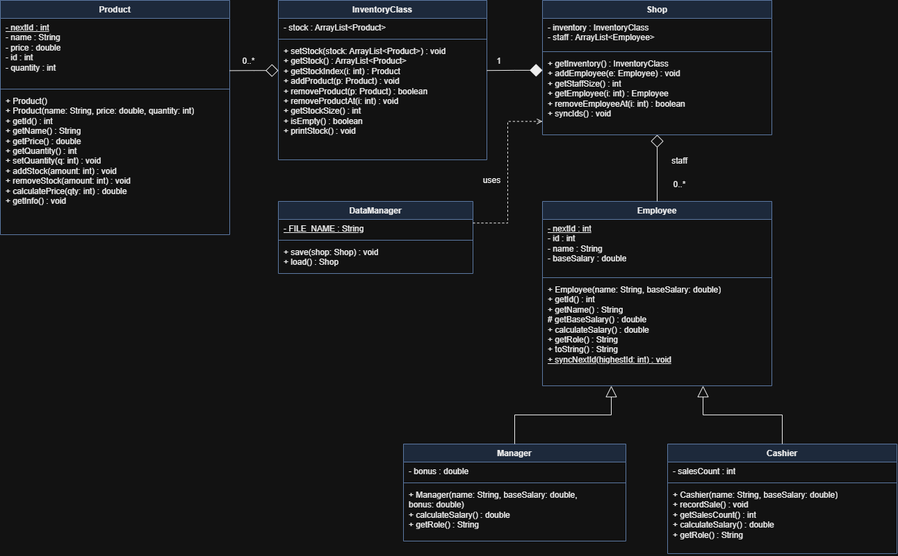

# Stationery Shop Management System

A console-based Java application that simulates the daily operations of a stationery shop: tracking inventory, selling and restocking products, and managing staff. All data is saved to disk, so the shop is exactly as you left it the next time you run the program.

Built for the **Object-Oriented Programming** course project (OOP_Course_0130231) at Al-Zaytoonah University of Jordan, 2026-2027 first semester.

## Features

- **Sell a product:** pick a product and a quantity, get the total, and the stock is reduced automatically
- **Restock:** add units to an existing product
- **Check stock:** list every product with its price and quantity
- **Add a product:** create a new product with a name, price and starting quantity
- **Manage employees:** add, list and remove staff (cashiers and managers), each with their own salary calculation
- **Persistent data:** the inventory and staff are saved after every change and loaded on startup
- **Input validation:** invalid numbers, negative values, empty names and out-of-range choices are rejected with a clear message

## OOP Concepts

| Concept | How it is used |
|---|---|
| **Objects and classes** | The shop is modeled with separate classes: `Product`, `InventoryClass`, `Employee`, `Shop` and `DataManager` |
| **Inheritance** | `Manager` and `Cashier` extend `Employee` and reuse its id, name and base salary |
| **Polymorphism** | `Manager` and `Cashier` override `calculateSalary()` and `getRole()`. The employee list is held as `Employee` objects, and each one runs its own version of the methods |
| **Aggregation** | `InventoryClass` holds `Product` objects and `Shop` holds `Employee` objects. Both are created elsewhere and added in, and they are independent objects |
| **Composition** | `Shop` creates and owns its `InventoryClass`. The inventory has no purpose without a shop |
| **Encapsulation** | Fields are `private` and accessed through getters and validated methods. Constructors reject invalid data |

## Project Structure

```
src/
├── Main.java            # Menu loop, user input and screens
├── Shop.java            # Owns the inventory and the staff list
├── InventoryClass.java  # Holds and manages the products
├── Product.java         # A product with a price and quantity
├── Employee.java        # Base class for staff
├── Manager.java         # Employee with a bonus
├── InputHelpers.java    # Scanner Class For Input
├── Cashier.java         # Employee paid per completed sale
└── DataManager.java     # Saves and loads the shop using Java serialization
```

## UML Class Diagram



- **Inheritance:** `Manager` and `Cashier` extend `Employee`
- **Composition:** `Shop` owns its `InventoryClass`
- **Aggregation:** `InventoryClass` holds `Product` objects, and `Shop` holds `Employee` objects
- **Dependency:** `DataManager` uses `Shop` to save and load the data

The editable draw.io source is in [`docs/StationeryShop_UML.drawio`](docs/StationeryShop_UML.drawio).

## How Saving Works

`DataManager` writes the whole `Shop` (inventory and staff) to a file called `shop.dat` using Java serialization. The classes that make up the shop implement `Serializable`, so everything inside them is saved in one step. On startup, the program loads `shop.dat`, or starts with an empty shop if the file does not exist yet.

If you change the fields of a saved class, delete `shop.dat` so the program starts from a fresh file.

## How to Run

Requires **JDK 11 or later**.

```bash
cd src
javac *.java
java Main
```

## Menu

```
1. Sell a product
2. Buy stock (restock)
3. Check stock
4. Add to stock
5. Manage employees
0. Exit
```

## Author

Yazan, Computer Science, Al-Zaytoonah University of Jordan
